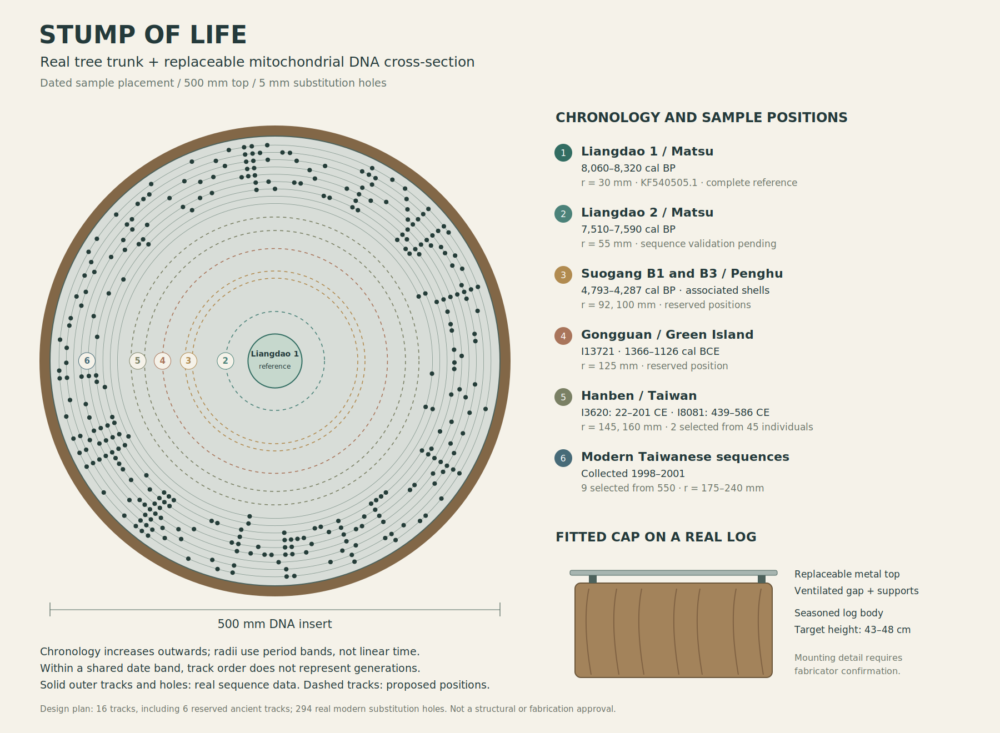

# Stump of Life

A `uv`-managed Python toolkit for turning real circular mitochondrial DNA into
auditable alignments and concentric sculpture patterns. Developed for Livia
Zaharia's proposed outdoor artwork: a metal tree-stump cross-section whose
perforations mark differences from an ancient mitochondrial sequence.

The first dataset is Liangdao Man and a small selection of modern Taiwanese
mitogenomes from Ko et al. (2014). A sampled ancient person is a comparison
reference, not a demonstrated direct ancestor of the other people.



See the [sample-site map](docs/images/sample-sites.png),
[site coordinates and sources](data/sites.csv), and
[real-log construction and supplier research](docs/trunk-and-fabrication.md).

## Quick start

Install [uv](https://docs.astral.sh/uv/) and
[MAFFT](https://mafft.cbrc.jp/alignment/software/) separately:

```bash
# Debian / Ubuntu
sudo apt-get install mafft
uv sync

uv run stump-of-life align examples/taiwan/mitogenomes.fasta \
  --reference-id KF540505.1 --output output/taiwan

uv run stump-of-life render output/taiwan/aligned.fasta \
  --reference-id KF540505.1 --output output/taiwan/full.svg --mode full

uv run stump-of-life render output/taiwan/aligned.fasta \
  --reference-id KF540505.1 --output output/taiwan/variable.svg --mode variable

uv run stump-of-life perforate output/taiwan/aligned.fasta \
  --reference-id KF540505.1 --output output/taiwan/metal \
  --diameter 500 --hole-diameter 5 --minimum-web 1.5
```

Open the SVGs in a browser or vector editor. `perforate` creates a physical-size
SVG with separate `CUT` and `ENGRAVE` groups, a hole-coordinate CSV and a measured
clearance report. Check the report before sending geometry to a fabricator.
Ring guides are engraved; cutting complete rings would detach the plate.

To download all 551 original sequences (one ancient plus 550 modern), with raw
response and checksums:

```bash
uv run stump-of-life fetch-taiwan --output data/modern/taiwan-panel
```

`--select ACCESSION` can be repeated for rendering or perforation. The reference
is always included. `--exclude-column NUMBER` suppresses a one-based alignment
column; exclusions must be declared rather than silently changing the data.

If MAFFT is outside `PATH`, use `align --mafft /path/to/mafft`. A relocated MAFFT
installation may also need `--mafft-binaries /path/to/lib/mafft` or the standard
`MAFFT_BINARIES` environment variable. Binaries are not bundled in this repository.

## What the alignment does

1. Validate ungapped IUPAC DNA records with unique FASTA identifiers. The inputs
   are assumed to represent complete circles; this cannot prove their biological completeness.
2. Find an exact, unambiguous anchor occurring once per circle across both strands.
3. Orient and rotate every sequence to that common anchor, validating with `edlib`.
4. Align these normalized sequences with MAFFT.
5. Rotate **all alignment columns together** to restore the deposited reference
   base 1. Insertions preceding base 1 remain after the last reference base.
6. Export the alignment, transformations, reference-coordinate map and variant
   table. Verify that MAFFT has preserved all input bases.

This is **reference-guided circular normalization followed by MAFFT**, a practical
heuristic for closely related, complete human mitogenomes. It is not a globally
optimal circular multiple alignment. Fragmented ancient genomes, rearrangements,
high divergence and unresolved repetitive origins need other methods. The
normalizer rejects uncertain origins or more than roughly five percent edits;
the common-anchor pipeline fails clearly if no shared exact anchor is available.

The approach follows the anchor → MSA → whole-column rotation method described
for the [rotate utility](https://github.com/richarddurbin/rotate) and its
[primary publication](https://pmc.ncbi.nlm.nih.gov/articles/PMC11056001/).
MAFFT strand adjustment alone does not resolve different circular starting points.

### Outputs of `align`

| File | Meaning |
|---|---|
| `normalized.fasta` | Oriented sequences rotated to the common anchor, before MAFFT |
| `aligned.fasta` | MSA restored to the original reference origin |
| `normalization.json` | Anchor, strand, rotation, edit distance, input hashes |
| `columns.csv` | One-based alignment columns mapped to reference positions or insertion flanks |
| `variants.csv` | Substitutions, insertions, deletions and unknown calls, kept distinct |
| `summary.json` | Per-sample counts and method |
| `mafft.log` | MAFFT's diagnostic output |

Coordinates refer to the sequence passed as `--reference-id`. They are **not
rCRS coordinates** unless that reference is explicitly `NC_012920.1`. Edlib's
normalization distance treats compatible IUPAC ambiguity as uncertainty; variant
calling only calls confident A/C/G/T differences. Neither step fills unknown DNA
from the reference.

## Two circular coordinate modes

**Full alignment:** all MSA columns have equally spaced angular positions,
including reference-gap insertion columns. This preserves alignment distances.

**Variable columns:** columns with at least two distinct known states across the
selected records receive equally spaced angular positions. This retains order
and alignment but compresses invariant stretches. Unknowns do not create a
variable column. Changing the selection changes this compressed angular scale.
This mode is intended to make differences visible at sculpture scale.

Presentation SVGs distinguish substitutions, insertions, deletions and unknowns.
Metal perforations encode **confident substitutions only**; skipped indels and
unknowns are counted in the export. A hole means “different called nucleotide
from this reference”, not a haplogroup, population, migration or direct ancestry.

The SVG and clearance report are design geometry, not structural certification.
Plate thickness, support, sitting loads, edges, corrosion and actual cutting
tolerances still require the fabricator's design review and a test coupon.
This version exports SVG and CSV; it does not yet export DXF or a structural mesh.

## Public example data

`examples/taiwan/mitogenomes.fasta` contains ten unmodified public complete
mitochondrial records: ancient Liangdao Man (`KF540505.1`) and nine modern
sequences. `metadata.csv` records the accession and the study's labels;
`provenance.json` records sources and checksums. This deliberately small selection
is an art-development example, not a representative population sample or a
collection of different historical generations.

Source: Ko et al. (2014), *Early Austronesians: Into and Out Of Taiwan*,
[American Journal of Human Genetics](https://doi.org/10.1016/j.ajhg.2014.02.003),
[open full text](https://pmc.ncbi.nlm.nih.gov/articles/PMC3951936/).
The study deposited 551 mitogenomes: one ancient and 550 modern sequences,
`KF540505`–`KF541055`. Those modern samples were collected in 1998–2001.
Study labels are supplied metadata, not genetic boundaries.

Data use and attribution remain subject to their original sources. No private
artist documents or site photographs are included in Git.

## Data and large files

Downloaded research data live under `data/`. Metadata, provenance and retrieval
scripts are tracked; raw sequencing files and bulky downloads are ignored.
Use the manifests to retrieve them again. Availability of a BAM does not mean a
complete, reliable ancient mitochondrial sequence is available.

Git LFS is configured for STL, OBJ, Blender, GLB, PLY and TIFF artwork assets.
Install Git LFS before adding these files. Downloadable sequencing data do not
need to be uploaded to GitHub merely to make the analysis reproducible.

## Development

### Ancient-data retrieval

```bash
uv sync --group research
uv run --group research python scripts/fetch_liangdao.py
uv run --group research python scripts/fetch_suogang.py
uv run --group research python scripts/fetch_hanben_gongguan.py
```

The scripts retain site/sample metadata, provenance and checksums. Indexed
mitochondrial range extraction avoids downloading complete nuclear BAMs; one
Hanben file without an index is streamed and filtered. Source archive MD5 values
are distinguished from checksums actually verified on complete downloaded files.

Liangdao-1 has a published complete mitochondrial FASTA. Liangdao-2 and the
Hanben/Gongguan acquisitions are mitochondrial read alignments, requiring
ancient-DNA-aware consensus calling before entering the FASTA alignment pipeline.
The public Suogang B1/B3 BAMs contain **only autosomal alignments and no MT reads**;
they do not supply usable mitochondrial sequences. Downloading all available
individuals does not establish complete mitogenomes for every individual.

To regenerate the design figures:

```bash
uv run --group preview python scripts/build_sample_map.py
uv run python scripts/build_concept_plate.py
```

The sample placement drawing reserves tracks for ancient sequences still awaiting
validation. All rendered substitution holes currently come from the real modern
example sequences compared with Liangdao-1. Dates describe observed people or
archaeological contexts; radial ordering is not a genealogy.

### Checks

```bash
uv sync
uv run pytest
uv run ruff check .
```

MAFFT integration tests run when `mafft` is on `PATH`, or when `MAFFT_PATH` is
set. Unit tests cover rotations, reverse complements, ambiguity, indels,
coordinate restoration, SVG escaping and perforation clearances. CI installs
MAFFT and runs the integration tests too.
